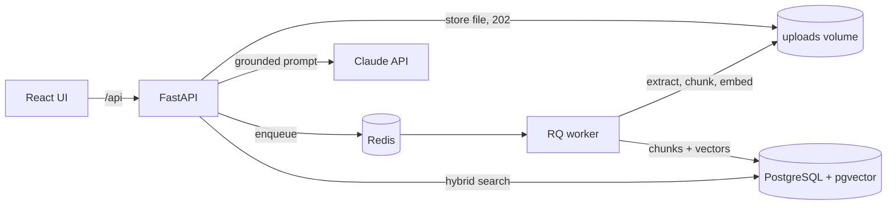

# RAG DocSearch

[](https://github.com/Dananjaya94/rag-docsearch/actions/workflows/ci.yml)

Self-hosted document search and question answering. Upload PDFs or Markdown, then ask questions that are answered **only from your documents**, with every claim cited back to a file and page.

**Stack:** FastAPI · PostgreSQL 16 + pgvector · Redis + RQ · sentence-transformers · Claude API · React + TypeScript · Docker Compose · GitHub Actions

## Why it's built this way

| Decision | Reason |
|---|---|
| **Hybrid retrieval** (pgvector cosine + Postgres full-text, fused with Reciprocal Rank Fusion) | Embeddings find paraphrases but blur exact tokens. Keyword search finds `RW-404` or a clause number instantly. RRF merges both rankings without tuning score weights. |
| **One database for vectors and metadata** | pgvector keeps chunks, documents and embeddings in one transactional store: no sync jobs, cascade deletes just work, and backups are one `pg_dump`. |
| **Async ingestion on a Redis queue** | Upload returns `202 Accepted` immediately. Extraction and embedding run in a separate worker with retries and a timeout, so a 300-page PDF never blocks the API. |
| **Idempotent jobs** | A retried job deletes any partial chunks before writing, so retries can't create duplicates. |
| **Content-hash deduplication** | Uploads are SHA-256 hashed while streaming; re-uploading the same file returns the existing document. |
| **Page-scoped chunks** | Chunks never cross a page boundary, so every citation points at exactly one page. |
| **Multilingual embeddings** | `paraphrase-multilingual-MiniLM-L12-v2` (384-dim) handles mixed-language document sets. |
| **Prompt-injection hygiene** | Sources are wrapped in tagged blocks and the model is told to treat them as data, not instructions. |
| **Runs without an API key** | With no `ANTHROPIC_API_KEY`, `/ask` returns the top passages (clearly labelled), so the stack is usable and testable offline. |

## Architecture



**Ingestion:** PyMuPDF page text → normalise (re-join hyphenation, strip soft hyphens) → paragraph-aware chunking with overlap → batched embeddings → one transaction.

**Query:** embed the question → top 40 by cosine distance (HNSW index) + top 40 by `ts_rank_cd` (GIN index) → RRF → top *k* chunks → numbered sources → Claude answers with `[n]` citations.

## Quick start

```bash
cp .env.example .env          # optionally add ANTHROPIC_API_KEY
docker compose up --build
```

- UI: http://localhost:8080
- API docs (OpenAPI): http://localhost:8000/docs

The first ingestion downloads the embedding model (~470 MB) into the `models` volume. To try it without the download, set `EMBEDDER=hashing` in `.env`.

## API

| Method | Path | Description |
|---|---|---|
| `POST` | `/documents` | Upload a file (multipart). `202` new, `200` duplicate, `413` too large, `415` unsupported type |
| `GET` | `/documents` | List documents with ingestion status |
| `GET` | `/documents/{id}` | Status, page and chunk counts, error if failed |
| `DELETE` | `/documents/{id}` | Remove the document, its chunks and the stored file |
| `POST` | `/search` | `{query, k, document_ids?}` → ranked chunks with vector and keyword ranks |
| `POST` | `/ask` | `{question, k, document_ids?}` → answer, mode (`llm` or `extractive`), citations |
| `GET` | `/health` | Database and Redis checks (`503` if either is down) |

```bash
curl -F "file=@handbook.pdf" localhost:8000/documents
curl localhost:8000/ask -H 'content-type: application/json' \
     -d '{"question": "Who approves expense claims above LKR 50,000?"}'
```

## Development

```bash
# backend (needs Postgres with pgvector; `docker compose up postgres redis` works)
cd backend
python -m venv .venv && . .venv/bin/activate
pip install -e ".[dev,embeddings]"
alembic upgrade head
uvicorn app.main:app --reload

# frontend
cd frontend && npm install && npm run dev   # proxies /api to :8000
```

### Tests

```bash
cd backend && pytest          # 26 tests: chunking, RRF, embedder, API, ingestion, queue, prompt
cd frontend && npm test       # citation parsing and UI behaviour
```

Backend tests run against a real Postgres + pgvector (a service container in CI), apply the Alembic migration from scratch, and use the offline hashing embedder so they're fast and deterministic. CI also lints with Ruff and oxlint and builds both Docker images.

## Configuration

All settings are environment variables; see [`.env.example`](.env.example) and [`backend/app/config.py`](backend/app/config.py). Changing `EMBEDDING_DIM` or the model requires a fresh database, because the vector column size is fixed by the migration.

## Project layout

```
backend/
  app/
    main.py         FastAPI routes
    ingestion.py    extract → chunk → embed → store job
    chunking.py     paragraph-aware, page-scoped chunking
    retrieval.py    hybrid search and RRF
    embeddings.py   sentence-transformers and hashing backends
    llm.py          grounded prompt and Claude client
  migrations/       Alembic (pgvector extension, HNSW and GIN indexes)
  tests/
frontend/           React + TypeScript (Vite), served by nginx in Docker
```

## Roadmap

- OCR for scanned PDFs (Tesseract) when a page has no text layer
- Streaming answers over Server-Sent Events
- Multi-tenant isolation with per-tenant document scoping
- Retrieval evaluation set (recall@k, MRR) in CI
- Cross-encoder re-ranking stage

## License

MIT
